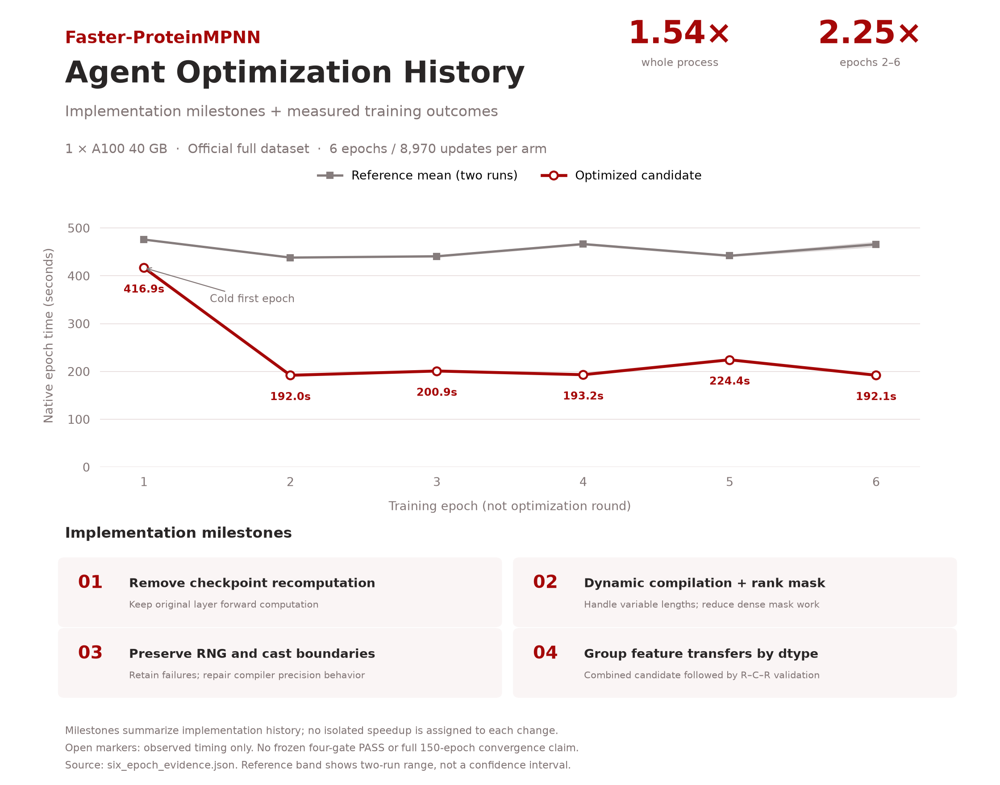

# Faster-ProteinMPNN

Infrastructure acceleration of [ProteinMPNN](https://github.com/dauparas/ProteinMPNN) training, inspired by [ResearchBoost-Agent](https://github.com/AI4AI-for-Anything/ResearchBoost-Agent). Pinned reference and optimized source, a bounded reproduction entry point, and observed results are included.

**Status: external exploratory case; not ResearchBoost four-gate certified.** The completed experiment covers six epochs, not the full 150-epoch recipe or a convergence guarantee.

## Agent Optimization History

Measured on **one A100 SXM4 40 GB**, using the official full dataset and the same per-epoch training recipe in all three runs. The figure follows the visual organization of the Faster-* case studies: implementation milestones, measured outcomes and explicit validation status.



The plot shows **training epochs, not optimization rounds**. We do not have comparable, accepted per-change measurements for every historical candidate, so we do not invent a cumulative round-by-round speedup curve. The four cards summarize the development sequence; they are not isolated ablations.

| Stage | Change / experiment | Recorded outcome |
| --- | --- | --- |
| 01 — recomputation | Call the original encoder/decoder layers directly, removing activation checkpoint recomputation | Retained in the final candidate; trades activation memory for less backward recomputation |
| 02 — compilation and masks | Explore full/region compilation and inverse decoding-order comparisons | Early static compilation reached a recompile limit; dynamic-shape compilation was pursued |
| 03 — numerical behavior | Inspect RNG and low-precision cast boundaries in generated code | Early flag-only attempts did not preserve all boundaries; a configuration-type failure was retained before repair |
| 04 — data transfer | Group feature transfers by dtype and combine with the compiled candidate | Final combined implementation; no per-change gain is inferred |
| Validation — small fixture | Three independent R–C–R groups plus short numerical trajectories | **2.13× steady-state** on the smaller fixture; cold short process was slower. This is a different workload from the six-epoch run |
| Validation — full dataset | Six complete epochs per arm, reference → candidate → reference | **1.54× whole-process**, **2.25× mean epoch time for epochs 2–6**; finite checkpoints and observed validation metrics, without four-gate certification |

[Implementation-history records](optimization-history.json) · [Plot source](plot_history.py) · [Vector figure](optimization-history.svg) · [Earlier fixture evidence](https://github.com/micky-li-hd/protein-infra-cases/blob/main/proteinmpnn-training.json)

The same final candidate was used throughout the six-epoch comparison. The first candidate epoch includes cold-start effects. Whole-process timing and native epoch timing have different boundaries and are reported separately below.

## Results

One NVIDIA A100 SXM4 40 GB, Python 3.12.11, PyTorch 2.5.1+cu121. The official full dataset and v_48_020 per-epoch settings were retained; the experiment was bounded to six epochs from scratch. Runs were sequential reference → candidate → reference, with isolated cold compiler caches. Each completed 8,970 optimizer updates.

| Measurement | Reference 1 | Candidate | Reference 2 | Ratio |
| --- | ---: | ---: | ---: | ---: |
| Whole process, seconds | 3316.216 | 2154.895 | 3316.182 | **1.54×** |
| Mean native epoch time, epochs 2–6, seconds | 449.46 | 200.52 | 451.84 | **2.25×** |
| Final validation perplexity | 5.934 | 5.884 | 5.897 | — |
| Final validation sequence accuracy | 0.445 | 0.447 | 0.446 | — |

Ratios use the mean of the two reference measurements divided by the candidate. Whole-process time includes cold compilation, loading, validation and checkpoint writing. Native epoch timing is a narrower upstream log scope; 2.25× is not the end-to-end claim. This is one R-C-R group, not multiple independent seeds or a confidence interval.

All three completed-run audits checked 472 finite checkpoint tensors. Close final validation metrics are observations, not a statistical equivalence verdict. `quality_accepted=false` and `four_gate_certified=false` remain unchanged. The candidate's first epoch took 416.9 s, versus 200.52 s on average in epochs 2–6; compilation overhead matters.

Machine-readable records: [six_epoch_evidence.json](six_epoch_evidence.json). Exact bounded settings: [six_epoch_recipe.json](six_epoch_recipe.json). The evidence consists of result and audit records, not full checkpoints or raw per-step trajectories.

## What changed

The candidate groups data transfers by dtype, replaces dense decoding-permutation operations with inverse-order comparisons for neighbor visibility, removes activation checkpoint recomputation, and enables dynamic-shape compilation. Compilation settings preserve random behavior and rounding boundaries. Removing recomputation trades memory for compute; these implementation choices are version sensitive.

The native model, loss, optimizer and per-epoch configuration are preserved. Both arms use the same explicit worker and prefetch seeding wrapper, replacing upstream entropy seeding. This alone does not prove exact data-order pairing.

## Reproduce

```bash
git clone https://github.com/micky-li-hd/Faster-ProteinMPNN.git
cd Faster-ProteinMPNN
python3.12 -m venv .venv
.venv/bin/python -m pip install -r requirements.txt
```

Download the full public dataset using the [pinned upstream training instructions](https://github.com/dauparas/ProteinMPNN/blob/8907e6671bfbfc92303b5f79c4b5e6ce47cdef57/training/README.md). Then run on an assigned, idle GPU:

```bash
PYTHON="$PWD/.venv/bin/python" bash scripts/run_six_epoch.sh /data/pdb_2021aug02 /shared/gpu_experiments.lock 0
```

The shared lock must match the lock used by other experiments. The launcher rejects a busy GPU, preserves failures and cleans only its owned processes. Each arm has a 7,200-second resource bound; a timeout is not counted as completion. Results go into a fresh `runs-six-epoch` directory. The script refuses to reuse it.

The optimized implementation is directly browsable in [`training/model_utils.py`](training/model_utils.py). The upstream source tree is pinned to [`8907e6671bfbfc92303b5f79c4b5e6ce47cdef57`](https://github.com/dauparas/ProteinMPNN/tree/8907e6671bfbfc92303b5f79c4b5e6ce47cdef57), with the original README preserved as [`README.upstream.md`](README.upstream.md). The original training modules for the reference arm are in [`reference/training/`](reference/training/); both arms use the same seeding and audit wrappers under [`scripts/`](scripts/). No archive extraction or patch application is needed.

The upstream examples and pretrained/example checkpoint files are retained unchanged. The full training dataset and checkpoints produced by our experiments are not included. The original 150-epoch recipe and historical startup checks are retained under `scripts/`; they are not evidence that 150 epochs completed. This layout-only revision preserves the published candidate/reference module hashes and six-epoch evidence. See [`SOURCE_LAYOUT.json`](SOURCE_LAYOUT.json) for provenance.


## Acknowledgements

ProteinMPNN code and derived changes follow its included MIT license. ResearchBoost-Agent and the Faster-* repositories inspired the experiment organization; this repository is an independent contribution, not an official certification or endorsement.
